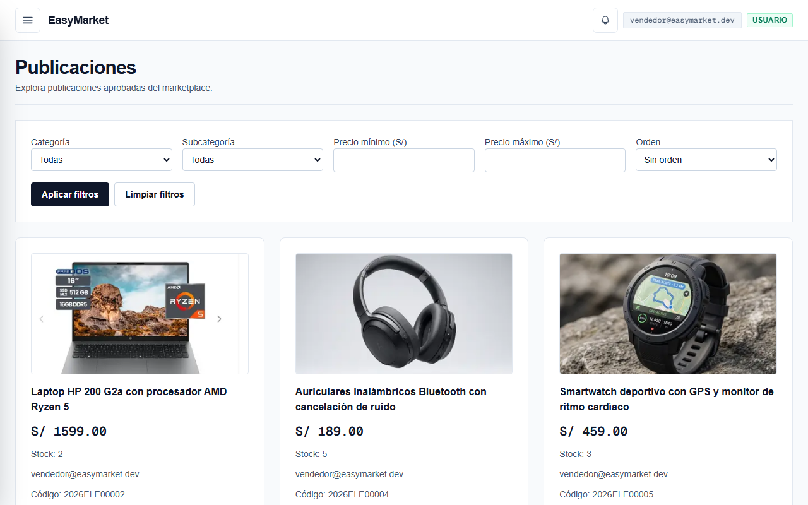
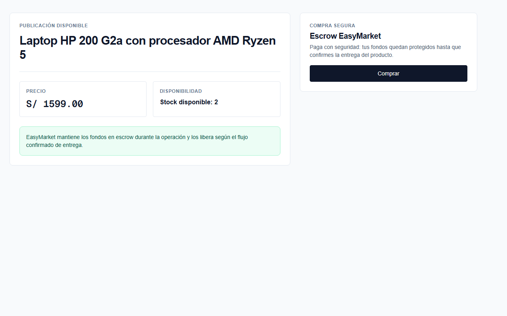
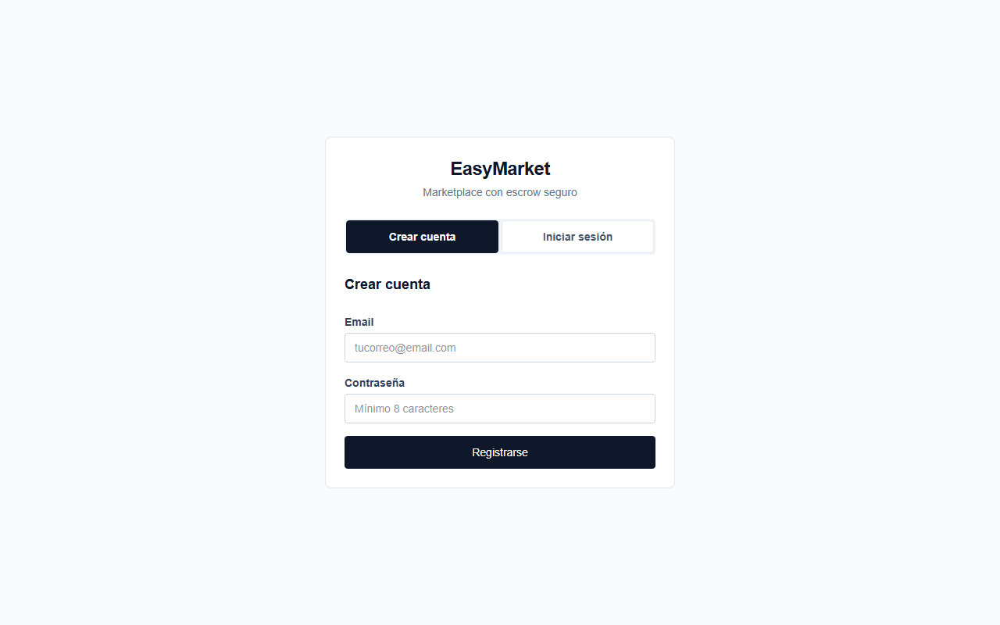
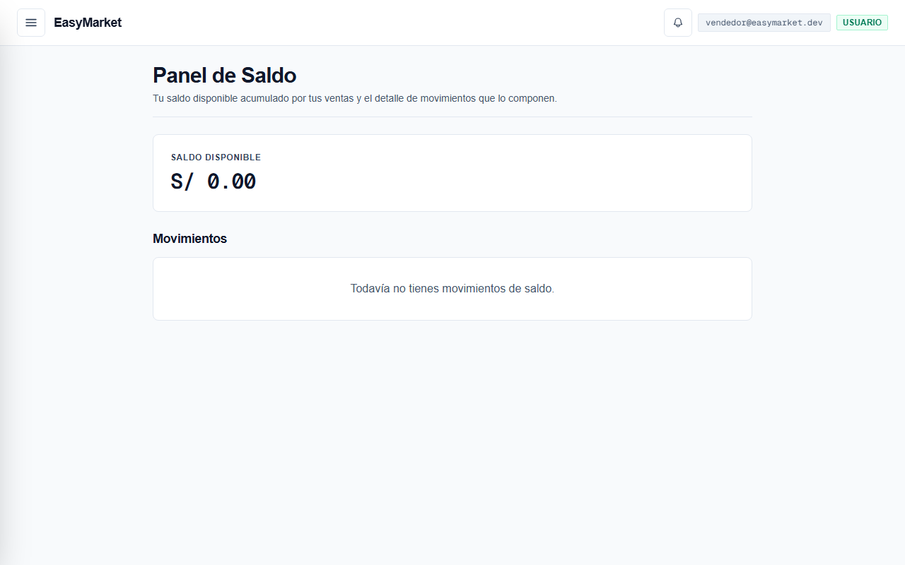

# EasyMarket — Marketplace P2P con Escrow

[](https://github.com/linochamorro/marketplace-P2P-escrow/actions/workflows/ci.yml)


> ⚠️ Proyecto de **portfolio técnico**, no un sistema de producción. Usa Stripe en modo sandbox, no mueve dinero real y el "saldo" del vendedor es un ledger contable interno, sin retiros a dinero real. Las capturas y comandos descritos reflejan el estado del código actual; no garantizan un despliegue operativo ni la disponibilidad de servicios externos.

---

## Contenido

- [Descripción del producto](#descripción-del-producto)
- [Funcionalidades](#funcionalidades)
- [Arquitectura](#arquitectura)
- [Stack](#stack)
- [Estados del negocio](#estados-del-negocio)
- [API](#api)
- [Requisitos](#requisitos)
- [Clonado y puesta en marcha](#clonado-y-puesta-en-marcha)
- [Comandos del proyecto](#comandos-del-proyecto)
- [Tests](#tests)
- [Seguridad](#seguridad)
- [Estructura del repositorio](#estructura-del-repositorio)
- [Documentación](#documentación)
- [Imágenes](#imágenes)
- [Licencia](#licencia)

---

## Descripción del producto

Marketplace peer-to-peer donde la plataforma actúa como intermediario de confianza: retiene el pago del comprador en escrow hasta confirmar la recepción del producto y solo entonces acredita el saldo al vendedor. Si hay disputa, un administrador la resuelve con trazabilidad total.

El sistema está compuesto por un cliente web (Next.js/React) y una API (Spring Boot/Java) que persiste en PostgreSQL con Flyway. Los pagos se procesan con Stripe en modo sandbox (captura inmediata), y el dinero se maneja siempre en enteros (centavos) dentro de una transacción de base de datos atómica. El ledger del vendedor es contable interno: no hay retiros a dinero real.

---

## Funcionalidades

- **Compra con escrow:** el pago se captura de inmediato (PEN, en centavos) y el webhook `payment_intent.succeeded` crea la transacción `reservada` con decremento atómico de stock y snapshot inmutable de precio, todo en una sola transacción de base de datos.
- **Disputa por la última unidad:** ante compras simultáneas gana el timestamp más temprano; el pago perdedor genera una orden durable de reembolso total, procesada sin duplicados.
- **Reembolsos por saga con outbox:** cancelaciones y disputas a favor del comprador emiten el reembolso a Stripe con clave idempotente determinista y reintentos seguros.
- **Webhooks verificados:** firma `Stripe-Signature` validada antes de tocar la base de datos, idempotencia por evento y por compra.
- **Automatización por tiempos:** confirmación automática a las 48 h sin respuesta, avisos de envío pendiente y avisos diarios, con zona horaria `America/Lima` (UTC-5).
- **Ledger auditable:** saldo cacheado + movimientos y eventos de transacción append-only protegidos a nivel de base de datos.
- **Catálogo moderado:** publicaciones con revisión, categorías y subcategorías, código de producto autogenerado e imágenes.
- **Cuentas con rate limiting:** bloqueo escalado ante intentos fallidos y desbloqueo administrativo auditado.
- **Notificaciones in-app** según rol, con accesos directos al flujo correspondiente.

---

## Arquitectura

```
┌──────────────┐  HTTPS + cookie de sesión  ┌──────────────────┐  JDBC     ┌────────────┐
│  Next.js 16  │ ─────────────────────────▶ │  Spring Boot 4   │ ────────▶ │ PostgreSQL │
│  (Vercel)    │ ◀───────────────────────── │  (Railway)       │           │ + Flyway   │
└──────────────┘   JSON                     └──────────────────┘           └────────────┘
       │ Stripe.js (PaymentElement)                 │ jobs programados
       ▼                                            ▼
┌──────────────┐                           ┌──────────────────┐
│ Stripe test  │ ◀── webhooks firmados ─── │ stripe-java      │
│ mode         │    (Stripe CLI en local)  │                  │
└──────────────┘                           └──────────────────┘
```

Decisiones principales: captura inmediata en lugar de auth-hold (las ventanas del escrow superan la vigencia de una autorización); ledger interno en lugar de transferencias reales; temporizadores por timestamp en base de datos; migraciones Flyway versionadas con validación estricta de esquema (`ddl-auto=validate`). El detalle está en [la arquitectura del sistema](docs/architecture/00-overview.md).

> La arquitectura documentada describe el código actual del repositorio. No acredita un despliegue operativo ni la disponibilidad actual de servicios externos (Railway, Vercel, Stripe).

---

## Stack

| Componente | Tecnología |
|---|---|
| Backend | Java 21, Spring Boot 4.1.0, Maven 3.9.16 |
| Frontend | React 19, Next.js 16.3.5, TypeScript 5.9 |
| Base de datos | PostgreSQL 16 + Flyway |
| Sesión | Spring Security + JWT en cookie `httpOnly; Secure; SameSite=None` |
| Pagos | Stripe en modo sandbox, captura inmediata |
| Tests backend | JUnit 5 + Testcontainers |
| Tests frontend | Vitest + React Testing Library, Playwright |
| CI | GitHub Actions |
| Despliegue (referencia, no verificado) | Railway (API) · Vercel (web) |
| Moneda / zona horaria | Soles en centavos (enteros) · America/Lima |

---

## Estados del negocio

**Publicación:** `pendiente_revisión` → `aprobada` · `pendiente_revisión` → `cambios_solicitados` ⇄ `pendiente_revisión` · `pendiente_revisión` → `rechazada` (editable o eliminable) · `aprobada` ⇄ `oculta` (sin stock ⇄ con stock).

**Transacción:** `reservada` → `enviado` → `entregado` → `recibido` · `entregado` + 48 h sin respuesta → `recibido_sin_respuesta` · `entregado` + reclamo → `disputa` → `completada` | `cancelada` · `reservada`/`enviado` + motivo → `cancelada`.

Las cancelaciones y rechazos exigen motivo y cada transición queda en el log de auditoría.

---

## API

| Método | Ruta | Descripción |
|---|---|---|
| `GET` | `/health` | Salud del servicio |
| `POST` | `/auth/registro`, `/auth/login`, `/auth/logout` | Autenticación (cookie de sesión) |
| `GET` | `/usuarios/me`, `/usuarios/me/saldo` | Identidad, saldo y movimientos |
| `GET` | `/categorias` | Árbol público de categorías |
| `POST/PUT/DELETE` | `/categorias/**` | Catálogo (admin) |
| `GET` | `/publicaciones`, `/publicaciones/{id}`, `/publicaciones/mias` | Listado con filtros, detalle, propias |
| `POST` | `/publicaciones` | Publicar un producto |
| `PATCH` | `/publicaciones/{id}`, `/corregir`, `/moderar` | Editar, corregir, moderar |
| `DELETE` | `/publicaciones/{id}` | Eliminar publicación propia |
| `POST` | `/compras` | Comprar (cabecera `Idempotency-Key`) |
| `PATCH` | `/transacciones/{id}/enviar\|/entregar\|/confirmar\|/reclamar\|/cancelar` | Ciclo del escrow |
| `GET` | `/transacciones/compras\|/ventas\|/{id}` | Consultas por actor |
| `PATCH` | `/disputas/{id}/resolver` | Resolución binaria (admin) |
| `GET` | `/notificaciones`, `/notificaciones/no-leidas/count` | Centro y contador |
| `PATCH` | `/notificaciones/{id}/leer` | Marcar como leída |
| `GET` | `/admin/tablero`, `/admin/disputas`, `/admin/usuarios/bloqueados` | Operación (admin) |
| `POST` | `/admin/usuarios/{id}/desbloquear` | Desbloqueo (admin) |
| `POST` | `/webhooks/stripe` | Webhook de Stripe (firma HMAC) |

Los errores responden `{"mensaje": "..."}`. En desarrollo hay documentación interactiva autogenerada (springdoc-openapi).

---

## Requisitos

- Java 21
- Maven 3.9+
- Node.js 20+
- PostgreSQL 16 (servidor local aislado para desarrollo)
- Stripe CLI y una cuenta de Stripe en modo test: **solo** cuando se ejecute la suite E2E completa o los recorridos de pago con webhooks. No son necesarios para arrancar la aplicación ni para navegar y capturar vistas localmente.

---

## Clonado y puesta en marcha

Cada paso indica el shell y el directorio de trabajo desde el que se ejecuta.

### 1. Clonar el repositorio

- **Shell:** cualquiera (bash/PowerShell). **Directorio de trabajo:** el elegido para el proyecto.

```bash
git clone https://github.com/linochamorro/marketplace-P2P-escrow.git
cd marketplace-P2P-escrow
```

### 2. Variables de entorno del backend

- **Shell:** cualquiera. **Directorio de trabajo:** raíz del repositorio.

```bash
cp .env.example .env
# Completar en .env: DB_*, STRIPE_*, JWT_SECRET, FRONTEND_URL, ADMIN_EMAIL y ADMIN_PASSWORD_HASH
```

Ver [.env.example](./.env.example). Los `.env` reales están ignorados por Git y nunca se versionan. `DB_PASSWORD` debe tener un valor no vacío: `docker-compose.yml` lo exige con la expresión `${DB_PASSWORD:?DB_PASSWORD es requerida}`.

### 3. Variables de entorno del frontend

- **Shell:** cualquiera. **Directorio de trabajo:** raíz del repositorio.

```bash
cd frontend
cp .env.example .env.local
# Completar: NEXT_PUBLIC_API_URL y NEXT_PUBLIC_STRIPE_PUBLISHABLE_KEY
cd ..
```

### 4. Crear y configurar PostgreSQL 16

- **Shell:** PowerShell (o el intérprete que corresponda a tu instalación). **Directorio de trabajo:** una carpeta fuera del árbol del repositorio donde residirán el clúster y sus binarios, o el directorio `bin/` de la instalación de PostgreSQL.

El entorno de validación de este repositorio usó PostgreSQL **16.16 nativo** (sin contenedores), con un clúster nuevo: usuario/superusuario `easymarket`, base de datos `easymarket_dev`, puerto `5432` en `127.0.0.1` (loopback), autenticación `scram-sha-256`, codificación UTF-8 y zona horaria `America/Lima`. Comandos equivalentes, con los binarios de PostgreSQL en el `PATH`:

```bash
# <data> = directorio nuevo y vacío para el clúster; <pwfile> = archivo temporal con la contraseña
initdb -D <data> -U easymarket --auth=scram-sha-256 --encoding=UTF8 --locale=C --pwfile=<pwfile>
# En <data>/postgresql.conf: listen_addresses = '127.0.0.1'  y  port = 5432
pg_ctl -D <data> -l <log> start
createdb -h 127.0.0.1 -p 5432 -U easymarket easymarket_dev
```

La contraseña se inyecta desde `DB_PASSWORD` del `.env` (por ejemplo mediante `--pwfile`), se usa un archivo temporal que debe borrarse enseguida y no se escribe en texto plano en la documentación. Comprueba el puerto libre antes de arrancar y no reutilices clústeres ni datos de otros proyectos. No se copian `.env`, dependencias ni bases de datos de otro entorno para que el proyecto "funcione".

Al arrancar el backend con perfil `dev`, Flyway crea el esquema y aplica las migraciones V1–V23 más el seed repeatable `R__seed_demo.sql` (24 migraciones en total).

### 5. Backend

- **Shell:** PowerShell. **Directorio de trabajo:** `backend/` (el `.env` de la raíz se lee con `..\.env`).

```powershell
cd backend
Get-Content ..\.env | ForEach-Object {
  if ($_ -match '^([A-Za-z_][A-Za-z0-9_]*)=(.*)$') {
    [Environment]::SetEnvironmentVariable($matches[1], $matches[2], 'Process')
  }
}
mvn spring-boot:run
```

Cuentas del seed de desarrollo:

| Rol | Email | Origen de la credencial |
|---|---|---|
| Vendedor | `vendedor@easymarket.dev` | Hash BCrypt insertado por `R__seed_demo.sql` |
| Comprador | `comprador@easymarket.dev` | Hash BCrypt insertado por `R__seed_demo.sql` |
| Admin | `ADMIN_EMAIL` del `.env` (por defecto `admin@easymarket.com`) | Hash BCrypt en `ADMIN_PASSWORD_HASH` del `.env` |

> El seed `R__seed_demo.sql` inserta **directamente** los hashes BCrypt de vendedor y comprador; sus contraseñas son credenciales fijas de demostración y no se documentan en texto plano ni se configuran desde el `.env`. La cuenta admin la siembra la migración `V6__seed_admin_usuario.sql` con `ADMIN_EMAIL` y `ADMIN_PASSWORD_HASH` de la configuración de desarrollo. Todas son credenciales sintéticas de demostración; no se usan en producción.

### 6. Frontend

- **Shell:** cualquiera. **Directorio de trabajo:** `frontend/`.

```bash
cd frontend
npm ci
npm run dev
```

### 7. Webhooks de Stripe en local (recorridos de pago y suite E2E)

- **Shell:** cualquiera con Stripe CLI instalado. **Directorio de trabajo:** raíz del repositorio.

```bash
stripe listen --forward-to http://localhost:8080/webhooks/stripe
# Copiar el whsec_... impreso a STRIPE_WEBHOOK_SECRET en el .env raíz y reiniciar el backend
```

La navegación y captura local de catálogo, detalle, acceso y paneles no requiere Stripe CLI. Los recorridos de pago sí dependen del reenvío de webhooks.

### 8. Suite E2E completa con Playwright

- **Shell:** cualquiera. **Directorio de trabajo:** `frontend/`.

```bash
cd frontend
npm run test:e2e
```

`npm run test:e2e` ejecuta `playwright test` con un `globalSetup` que valida el entorno antes de los specs: PostgreSQL en `127.0.0.1:5432`, backend en perfil `dev` (`/health` → 200 con seed presente), CORS, frontend en `localhost:3000`, Stripe CLI reenviando a `http://localhost:8080/webhooks/stripe`, claves Stripe reales (no placeholders) en `.env` y `.env.local`, variables `ADMIN_EMAIL` y `ADMIN_PASSWORD` definidas (el harness comprueba su definición; el seed consume `ADMIN_PASSWORD_HASH`) y ausencia de secretos en archivos versionados. Por tanto, la suite completa exige **PostgreSQL, backend dev, frontend y Stripe CLI** corriendo. No debe confundirse con la navegación/captura local descrita en el paso 7, que no necesita Stripe CLI.

---

## Comandos del proyecto

| Comando | Uso |
|---|---|
| `mvn spring-boot:run` | Backend: arranque en perfil dev contra PostgreSQL local (no requiere Docker) |
| `mvn test` | Backend: tests JUnit 5 + Testcontainers; **requiere Docker** disponible en la máquina |
| `npm ci` (frontend) | Frontend: instalar dependencias declaradas |
| `npm run dev` (frontend) | Servidor de desarrollo Next.js |
| `npm run lint` (frontend) | ESLint |
| `npx tsc --noEmit` (frontend) | TypeScript estricto |
| `npm test` (frontend) | Vitest + React Testing Library |
| `npm run build` (frontend) | Build de producción |
| `npm run test:e2e` (frontend) | Suite Playwright completa; requiere PostgreSQL, backend dev, frontend y Stripe CLI (ver paso 8) |

El workflow de CI (`.github/workflows/ci.yml`) ejecuta estas mismas comprobaciones en cada push y pull request: backend (JDK 21, con Testcontainers sobre el Docker del runner) y frontend (Node 20).

---

## Tests

Las pruebas conviven con cada aplicación; el repositorio no tiene un directorio `tests/` separado:

- `backend/src/test`: JUnit 5 + Testcontainers (`mvn test` requiere Docker).
- `frontend/src`: Vitest + React Testing Library (`npm test`).
- `frontend/src/e2e`: specs Playwright y validación de entorno (`npm run test:e2e`, requisitos en el paso 8).

---

## Seguridad

- Sesión en cookie `httpOnly` (inaccesible para JavaScript).
- Validación de `Origin` en métodos de escritura, con exención del webhook de Stripe.
- Validación de entrada en login/registro y rate limiting persistente.
- Webhooks por firma HMAC sobre el cuerpo crudo, con idempotencia por evento y por compra.
- Cabeceras `X-Content-Type-Options`, `X-Frame-Options: DENY`, `Referrer-Policy`, `Permissions-Policy` mínima y CSP en modo Report-Only con allowlist de Stripe.
- Dinero solo en enteros y secretos solo en variables de entorno.

---

## Estructura del repositorio

```
marketplace-P2P-escrow/
├── README.md                          # Documentación pública (este archivo)
├── .env.example                       # Plantilla backend (no versionar valores reales)
├── frontend/.env.example              # Plantilla frontend
├── docker-compose.yml                 # Referencia PostgreSQL local (DB_PASSWORD requerida, sin contraseña literal)
├── .github/workflows/ci.yml           # CI backend + frontend
├── .gitignore                         # Exclusiones del repositorio
├── backend/                           # API — Java 21 + Spring Boot
│   ├── src/main/java/.../             # controllers, services, model, repository,
│   │                                 # security, config, dto, exception
│   ├── src/main/resources/
│   │   ├── application-dev.yml / application-prod.yml
│   │   ├── db/migration/              # Flyway V1–V23
│   │   └── db/dev/                    # R__seed_demo.sql (solo perfil dev)
│   └── src/test/                      # JUnit 5 + Testcontainers (ubicación real de los tests)
├── frontend/                          # Next.js + React + Tailwind
│   ├── src/app/                       # Rutas y paneles (mercado, escrow, admin)
│   ├── src/e2e/                       # Specs Playwright + validación de entorno
│   ├── next.config.ts                 # Cabeceras de seguridad + CSP Report-Only
│   └── .env.example
└── docs/
    ├── architecture/                  # Arquitectura del sistema
    ├── decisions/                     # Decisiones técnicas de formato y visibilidad
    └── images/                        # Capturas funcionales (galería integrada en este README)
```

---

## Imágenes

Capturas reales del producto ejecutado localmente (PostgreSQL 16.16 aislado, datos sintéticos y backend/frontend en vivo), obtenidas con Playwright CLI 1.61.1 (`playwright screenshot`, Chromium). No son diseños de referencia ni maquetas estáticas; no muestran credenciales, tokens ni datos personales reales.

### Vistas principales

**Inicio institucional**


**Explorar publicaciones**



**Detalle del producto y compra segura**



**Acceso seguro**



**Panel de administración**


**Gestión de transacción / escrow**


<details>
<summary>Otras vistas</summary>

**Mis publicaciones**


**Centro de notificaciones**


**Panel de saldo**



**Comprobación móvil**


</details>

> Las vistas de compras, notificaciones y saldo reflejan el estado vacío del seed de demostración: no hay transacciones porque éstas se crean con el flujo real de pago y webhook de Stripe, que no forma parte de la navegación local capturada. Las capturas acreditan las superficies reales accesibles en ese estado.

---

## Documentación

- [Arquitectura del sistema](docs/architecture/00-overview.md)
- [Decisiones técnicas de formato y visibilidad](docs/decisions/index.md)
- [Galería de capturas funcionales](docs/images/README.md)
- [Estructura del repositorio](#estructura-del-repositorio)

---

## Licencia

Sin licencia definida — todos los derechos reservados.

> EasyMarket no tiene licencia definida. No se adopta MIT ni ninguna otra licencia por analogía con proyectos de referencia.
