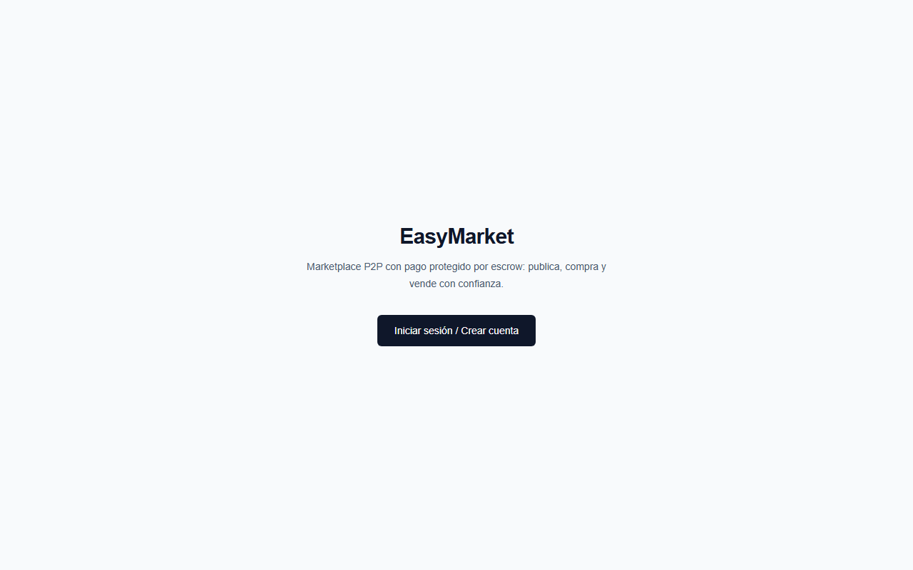
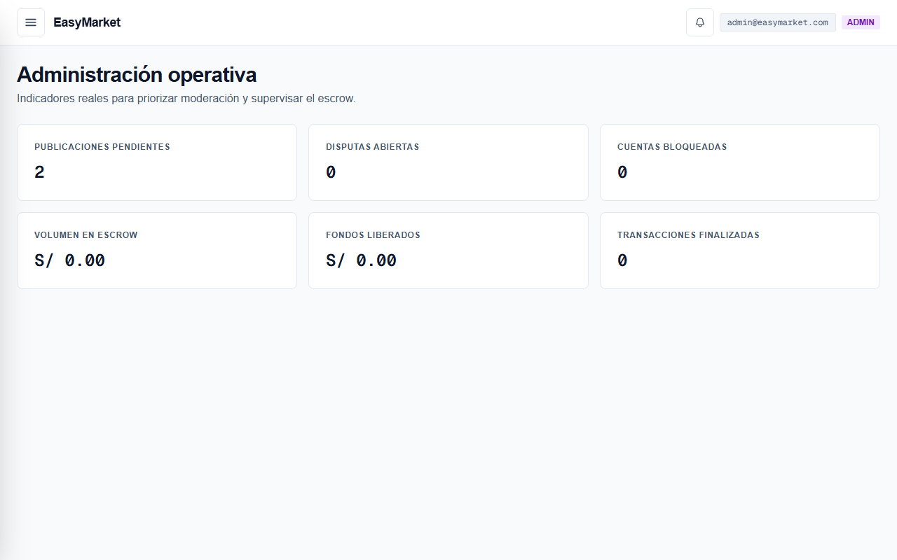
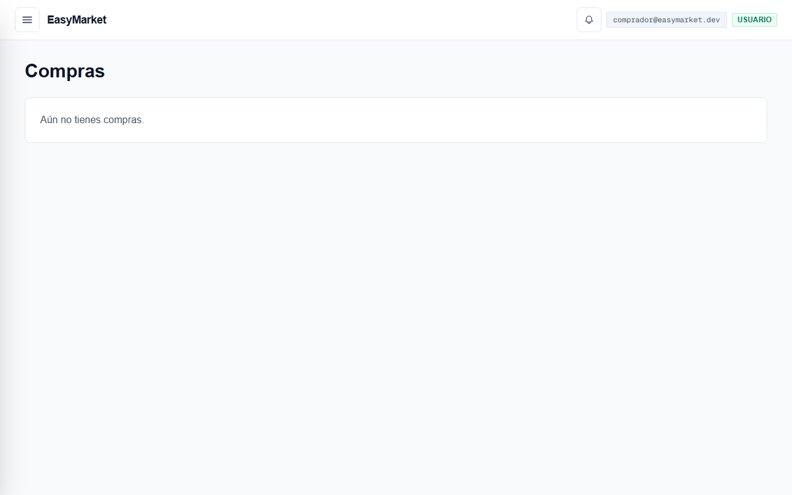
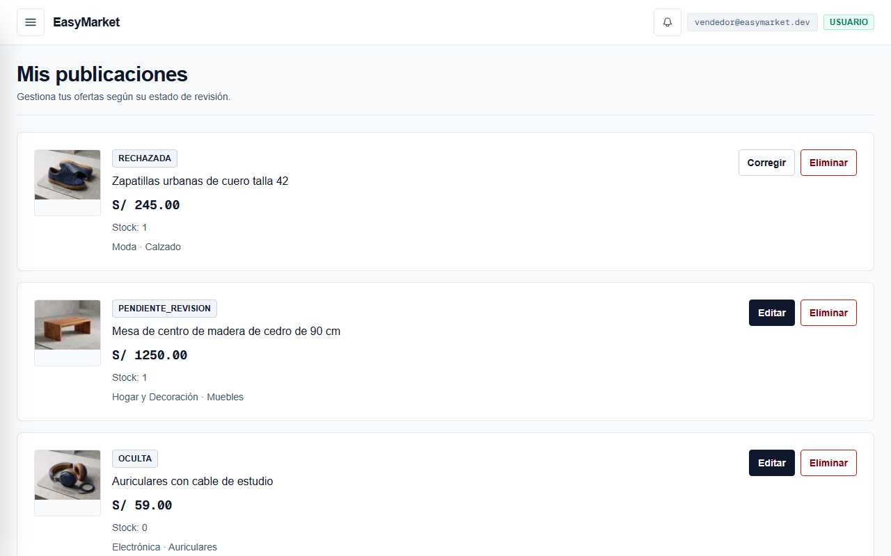
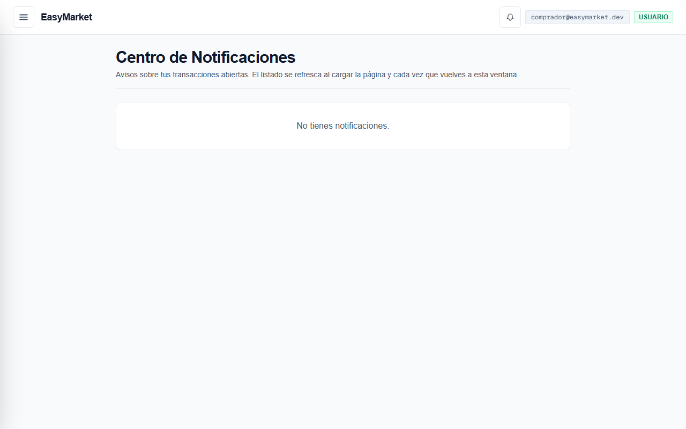
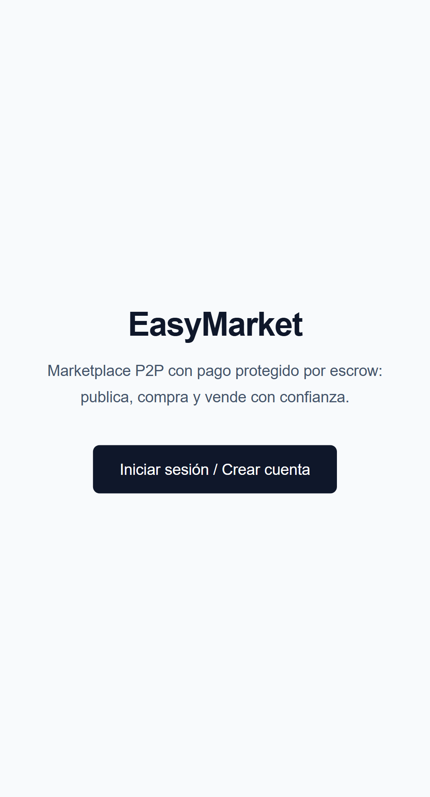

# EasyMarket — Marketplace P2P con Escrow

[](https://github.com/linochamorro/marketplace-P2P-escrow/actions/workflows/ci.yml)


> ⚠️ Proyecto de **portfolio técnico**, no un sistema de producción. Usa Stripe en modo sandbox, no mueve dinero real y el "saldo" del vendedor es un ledger contable interno, sin retiros a dinero real. Las capturas y comandos descritos reflejan el estado del código actual; no garantizan un despliegue operativo ni la disponibilidad de servicios externos.

---

## Contenido

- [Descripción del producto](#descripción-del-producto)
- [Funcionalidades](#funcionalidades)
- [Arquitectura](#arquitectura)
- [Stack](#stack)
- [Estados del negocio](#estados-del-negocio)
- [API](#api)
- [Requisitos](#requisitos)
- [Clonado y puesta en marcha](#clonado-y-puesta-en-marcha)
- [Comandos del proyecto](#comandos-del-proyecto)
- [Tests](#tests)
- [Seguridad](#seguridad)
- [Estructura del repositorio](#estructura-del-repositorio)
- [Documentación](#documentación)
- [Imágenes](#imágenes)
- [Licencia](#licencia)

---

## Descripción del producto

Marketplace peer-to-peer donde la plataforma actúa como intermediario de confianza: retiene el pago del comprador en escrow hasta confirmar la recepción del producto y solo entonces acredita el saldo al vendedor. Si hay disputa, un administrador la resuelve con trazabilidad total.

El sistema está compuesto por un cliente web (Next.js/React) y una API (Spring Boot/Java) que persiste en PostgreSQL con Flyway. Los pagos se procesan con Stripe en modo sandbox (captura inmediata), y el dinero se maneja siempre en enteros (centavos) dentro de una transacción de base de datos atómica. El ledger del vendedor es contable interno: no hay retiros a dinero real.

---

## Funcionalidades

- **Compra con escrow:** el pago se captura de inmediato (PEN, en centavos) y el webhook `payment_intent.succeeded` crea la transacción `reservada` con decremento atómico de stock y snapshot inmutable de precio, todo en una sola transacción de base de datos.
- **Disputa por la última unidad:** ante compras simultáneas gana el timestamp más temprano; el pago perdedor genera una orden durable de reembolso total, procesada sin duplicados.
- **Reembolsos por saga con outbox:** cancelaciones y disputas a favor del comprador emiten el reembolso a Stripe con clave idempotente determinista y reintentos seguros.
- **Webhooks verificados:** firma `Stripe-Signature` validada antes de tocar la base de datos, idempotencia por evento y por compra.
- **Automatización por tiempos:** confirmación automática a las 48h sin respuesta, avisos de envío pendiente y avisos diarios, con hora de Perú (UTC-5).
- **Ledger auditable:** saldo cacheado + movimientos y eventos de transacción append-only protegidos a nivel de base de datos.
- **Catálogo moderado:** publicaciones con revisión, categorías y subcategorías, código de producto autogenerado e imágenes.
- **Cuentas con rate limiting:** bloqueo escalado ante intentos fallidos y desbloqueo administrativo auditado.
- **Notificaciones in-app** según rol, con accesos directos al flujo correspondiente.

---

## Arquitectura

```
┌──────────────┐  HTTPS + cookie de sesión  ┌──────────────────┐  JDBC     ┌────────────┐
│  Next.js 16  │ ─────────────────────────▶ │  Spring Boot 4   │ ────────▶ │ PostgreSQL │
│  (Vercel)    │ ◀───────────────────────── │  (Railway)       │           │ + Flyway   │
└──────────────┘   JSON                     └──────────────────┘           └────────────┘
       │ Stripe.js (PaymentElement)                 │ jobs programados
       ▼                                            ▼
┌──────────────┐                           ┌──────────────────┐
│ Stripe test  │ ◀── webhooks firmados ─── │ stripe-java      │
│ mode         │    (Stripe CLI en local)  │                  │
└──────────────┘                           └──────────────────┘
```

Decisiones principales: captura inmediata en lugar de auth-hold (las ventanas del escrow superan la vigencia de una autorización); ledger interno en lugar de transferencias reales; temporizadores por timestamp en base de datos; migraciones Flyway versionadas con validación estricta de esquema (`ddl-auto=validate`).

> La arquitectura documentada describe el código actual del repositorio. No acredita un despliegue operativo ni la disponibilidad actual de servicios externos (Railway, Vercel, Stripe).

---

## Stack

| Componente | Tecnología |
|---|---|
| Backend | Java 21, Spring Boot 4.1.0, Maven 3.9.16 |
| Frontend | React 19, Next.js 16.3.5, TypeScript 5.9 |
| Base de datos | PostgreSQL 16 + Flyway |
| Sesión | Spring Security + JWT en cookie `httpOnly; Secure; SameSite=None` |
| Pagos | Stripe en modo sandbox, captura inmediata |
| Tests backend | JUnit 5 + Testcontainers |
| Tests frontend | Vitest + React Testing Library, Playwright |
| CI | GitHub Actions |
| Despliegue (referencia, no verificado) | Railway (API) · Vercel (web) |
| Moneda / zona horaria | Soles en centavos (enteros) · America/Lima |

---

## Estados del negocio

**Publicación:** `pendiente_revisión` → `aprobada` · `pendiente_revisión` → `cambios_solicitados` ⇄ `pendiente_revisión` · `pendiente_revisión` → `rechazada` (editable o eliminable) · `aprobada` ⇄ `oculta` (sin stock ⇄ con stock).

**Transacción:** `reservada` → `enviado` → `entregado` → `recibido` · `entregado` + 48h sin respuesta → `recibido_sin_respuesta` · `entregado` + reclamo → `disputa` → `completada` | `cancelada` · `reservada`/`enviado` + motivo → `cancelada`.

Las cancelaciones y rechazos exigen motivo y cada transición queda en el log de auditoría.

---

## API

| Método | Ruta | Descripción |
|---|---|---|
| `GET` | `/health` | Salud del servicio |
| `POST` | `/auth/registro`, `/auth/login`, `/auth/logout` | Autenticación (cookie de sesión) |
| `GET` | `/usuarios/me`, `/usuarios/me/saldo` | Identidad, saldo y movimientos |
| `GET` | `/categorias` | Árbol público de categorías |
| `POST/PUT/DELETE` | `/categorias/**` | Catálogo (admin) |
| `GET` | `/publicaciones`, `/publicaciones/{id}`, `/publicaciones/mias` | Listado con filtros, detalle, propias |
| `POST` | `/publicaciones` | Publicar un producto |
| `PATCH` | `/publicaciones/{id}`, `/corregir`, `/moderar` | Editar, corregir, moderar |
| `DELETE` | `/publicaciones/{id}` | Eliminar publicación propia |
| `POST` | `/compras` | Comprar (cabecera `Idempotency-Key`) |
| `PATCH` | `/transacciones/{id}/enviar\|/entregar\|/confirmar\|/reclamar\|/cancelar` | Ciclo del escrow |
| `GET` | `/transacciones/compras\|/ventas\|/{id}` | Consultas por actor |
| `PATCH` | `/disputas/{id}/resolver` | Resolución binaria (admin) |
| `GET` | `/notificaciones`, `/notificaciones/no-leidas/count` | Centro y contador |
| `PATCH` | `/notificaciones/{id}/leer` | Marcar como leída |
| `GET` | `/admin/tablero`, `/admin/disputas`, `/admin/usuarios/bloqueados` | Operación (admin) |
| `POST` | `/admin/usuarios/{id}/desbloquear` | Desbloqueo (admin) |
| `POST` | `/webhooks/stripe` | Webhook de Stripe (firma HMAC) |

Los errores responden `{"mensaje": "..."}`. En desarrollo hay documentación interactiva autogenerada (springdoc-openapi).

---

## Requisitos

- Java 21
- Maven 3.9+
- Node.js 20+
- PostgreSQL 16 (local aislado para desarrollo)
- Stripe CLI (solo para webhooks locales en modo sandbox)
- Cuenta de Stripe en modo test (claves públicas/secretas de sandbox)

> PostgreSQL local aislado y dependencias declaradas ya fueron aprobados por Lino (G-4/G-8). Docker y Stripe CLI no se instalan ni se usan en este mantenimiento por decisión expresa (ADR-001).

---

## Clonado y puesta en marcha

1. Clona el repositorio y entra en su carpeta:

   ```bash
   git clone https://github.com/linochamorro/marketplace-P2P-escrow.git
   cd marketplace-P2P-escrow
   ```

2. Configura las variables de entorno del backend (plantilla versionada, valores reales solo en local):

   ```bash
   cp .env.example .env   # completar: DB_*, STRIPE_*, JWT_SECRET, FRONTEND_URL, ADMIN_*
   ```

   Ver [.env.example](./.env.example). Los `.env` reales están ignorados por Git y nunca se versionan.

3. Configura las variables de entorno del frontend:

   ```bash
   cd frontend
   cp .env.example .env.local   # NEXT_PUBLIC_API_URL, NEXT_PUBLIC_STRIPE_PUBLISHABLE_KEY
   cd ..
   ```

4. Arranca PostgreSQL local aislado (puerto libre, loopback, usuario/BD exclusivos; credenciales nuevas locales, no impresas):

   ```bash
   # Ejemplo con PostgreSQL nativo (instalado por el usuario, no por este repositorio)
   # Crear BD y usuario: easymarket_dev / easymarket
   # Aplicar migraciones Flyway y seed de desarrollo (perfil dev)
   ```

   No se copia `.env`, `node_modules`, caches ni base de datos del desarrollo para que "funcione".

5. Backend:

   ```bash
   # Cargar el .env raíz en el proceso (PowerShell, desde backend/)
   Get-Content ..\.env | ForEach-Object {
     if ($_ -match '^([A-Za-z_][A-Za-z0-9_]*)=(.*)$') {
       [Environment]::SetEnvironmentVariable($matches[1], $matches[2], 'Process')
     }
   }

   mvn test
   mvn spring-boot:run
   ```

   Cuentas demo del seed local (configurables vía `.env`, no versionadas):

   | Rol | Email | Password |
   |---|---|---|
   | Vendedor | `vendedor@easymarket.dev` | Configurar localmente |
   | Comprador | `comprador@easymarket.dev` | Configurar localmente |
   | Admin | vía `ADMIN_EMAIL` del `.env` | vía variable local, nunca versionada |

   > Las contraseñas de demo no se documentan en texto plano en este README. Se generan localmente con BCrypt desde el `.env` y el seed.

6. Frontend:

   ```bash
   cd frontend
   npm ci
   npm run dev
   ```

7. Webhooks de Stripe en local (sandbox, solo si se cuenta con Stripe CLI autorizado):

   ```bash
   stripe listen --forward-to http://localhost:8080/webhooks/stripe
   # Copiar el whsec_... impreso a STRIPE_WEBHOOK_SECRET en el .env raíz
   # y reiniciar el backend
   ```

   > Sin Stripe CLI, los recorridos de pago externo quedan pendientes; las vistas de catálogo, detalle, acceso y administración son capturables sin Stripe.

8. Tests E2E con Playwright (vistas no dependientes de Stripe):

   ```bash
   cd frontend
   npm run test:e2e
   ```

   El harness valida el entorno local antes de correr los specs. Los servicios requeridos deben estar corriendo (PostgreSQL, backend `dev` y frontend).

---

## Comandos del proyecto

| Comando | Uso |
|---|---|
| `mvn test` | Backend: tests JUnit 5 + Testcontainers (requiere Docker; pendiente por ADR-001) |
| `mvn spring-boot:run` | Backend: arranque en perfil dev |
| `npm ci` (frontend) | Frontend: instalar dependencias declaradas |
| `npm run dev` (frontend) | Servidor de desarrollo Next.js |
| `npm run lint` (frontend) | ESLint |
| `npx tsc --noEmit` (frontend) | TypeScript estricto |
| `npm test` (frontend) | Vitest + React Testing Library |
| `npm run build` (frontend) | Build de producción |
| `npm run test:e2e` (frontend) | Playwright E2E |

El workflow de CI (`.github/workflows/ci.yml`) ejecuta estos mismos gates en cada push y pull request: backend (JDK 21) y frontend (Node 20).

---

## Seguridad

- Sesión en cookie `httpOnly` (inaccesible para JavaScript).
- Validación de `Origin` en métodos de escritura, con exención del webhook de Stripe.
- Validación de entrada en login/registro y rate limiting persistente.
- Webhooks por firma HMAC sobre el cuerpo crudo, con idempotencia por evento y por compra.
- Cabeceras `X-Content-Type-Options`, `X-Frame-Options: DENY`, `Referrer-Policy`, `Permissions-Policy` mínima y CSP en modo Report-Only con allowlist de Stripe.
- Dinero solo en enteros y secretos solo en variables de entorno.

---

## Estructura del repositorio

```
marketplace-P2P-escrow/
├── README.md                          # Documentación pública (este archivo)
├── .env.example                       # Plantilla backend (ignorar valores reales)
├── frontend/.env.example              # Plantilla frontend
├── docker-compose.yml                 # Referencia PostgreSQL local (INCLUIR: sin contraseña en texto plano; POSTGRES_PASSWORD sin default)
├── .github/workflows/ci.yml           # CI backend + frontend
├── .gitignore                         # Exclusiones conforme a G-6b
├── backend/                           # API — Java 21 + Spring Boot
│   ├── src/main/java/.../             # controllers, services, model, repository,
│   │                                 # security, config, dto, exception
│   ├── src/main/resources/
│   │   ├── application-dev.yml / application-prod.yml
│   │   └── db/migration/              # Flyway V1–V23 · db/dev/seed solo-dev
│   └── src/test/                      # JUnit 5 + Testcontainers
├── frontend/                          # Next.js + React + Tailwind
│   ├── src/app/                       # Rutas y paneles (mercado, escrow, admin)
│   ├── src/e2e/                       # Specs Playwright + validación de entorno
│   ├── next.config.ts                 # Cabeceras de seguridad + CSP Report-Only
│   └── .env.example
├── docs/
│   ├── architecture/                  # Arquitectura del sistema (docs técnico público)
│   ├── decisions/                     # Decisiones técnicas de formato/visibilidad (docs/decisions/index.md)
│   ├── runbooks/                      # Guías operativas (pendiente de contenido; EXCLUIR G-6b)
│   └── sdd/                           # Constitución, especificación, plan, roadmap y paquetes (INTERNO — EXCLUIR G-6b)
├── docs/images/                       # Capturas reales (galería integrada en README)
├── tests/                             # Pruebas separadas (canónico pendiente de consolidación)
├── reports/                           # Reportes de implementación, auditoría y verificación (no públicos; EXCLUIR G-6b)
├── .agents/                           # Contratos de roles de agente (no públicos; EXCLUIR G-6b)
└── .gitignore                         # Exclusiones conforme a G-6b
```

> `docs/sdd/`, `reports/`, `.agents/`, `AGENTS.md`, `STATE.md`, `DESIGN.md` y `docs/runbooks/` son documentos internos de proceso y **no** forman parte del árbol público bajo decisión G-6b. La selección de archivos públicos se rige por las exclusiones declaradas en `.gitignore` y por la decisión G-6b; no se enlaza aquí ningún documento de proceso interno.

---

## Imágenes

Capturas reales del producto ejecutado localmente (PostgreSQL 16 aislado, datos sintéticos y backend/frontend en vivo), obtenidas con Playwright CLI 1.61.1 (`playwright screenshot`, Chromium). No son diseños de referencia ni `code.html` de Stitch; no muestran credenciales, tokens ni datos personales reales.

### Vistas principales

**Inicio institucional**



**Explorar publicaciones**


**Detalle del producto y compra segura**


**Acceso seguro**


**Panel de administración**



**Gestión de transacción / escrow**



<details>
<summary>Otras vistas</summary>

**Mis publicaciones**



**Centro de notificaciones**



**Panel de saldo**


**Comprobación móvil**



</details>

> Las vistas de compras, notificaciones y saldo reflejan el estado vacío del seed de demostración: las transacciones de pago requieren Stripe en sandbox, cuyo recorrido externo no se repite en este mantenimiento según ADR-001. Las capturas acreditan las superficies reales accesibles sin ese servicio.

---

## Documentación

- [Arquitectura del sistema](docs/architecture/00-overview.md)
- [Decisiones técnicas de formato y visibilidad](docs/decisions/index.md)
- [Estructura del repositorio](#estructura-del-repositorio)

> La selección de archivos públicos se rige por las exclusiones declaradas en `.gitignore` y por la decisión G-6b. No se enlaza desde este README ningún documento de proceso interno (`docs/sdd/`, `reports/`, `.agents/`, `AGENTS.md`, `STATE.md`, `DESIGN.md`, `docs/runbooks/`).

---

## Licencia

Sin licencia definida — todos los derechos reservados.

> EasyMarket no tiene licencia definida. No se adopta MIT ni ninguna otra licencia por analogía con proyectos de referencia.
